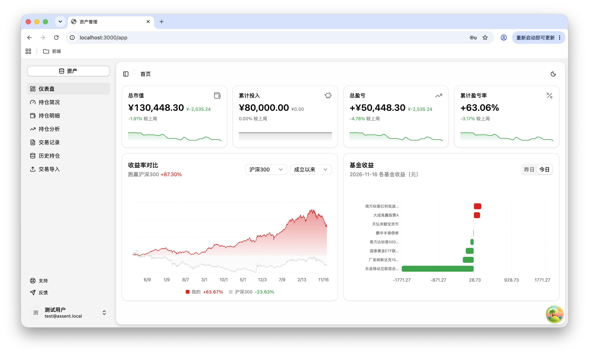
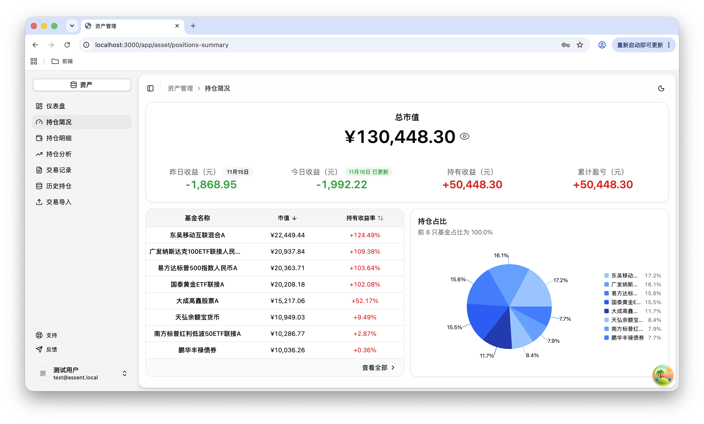
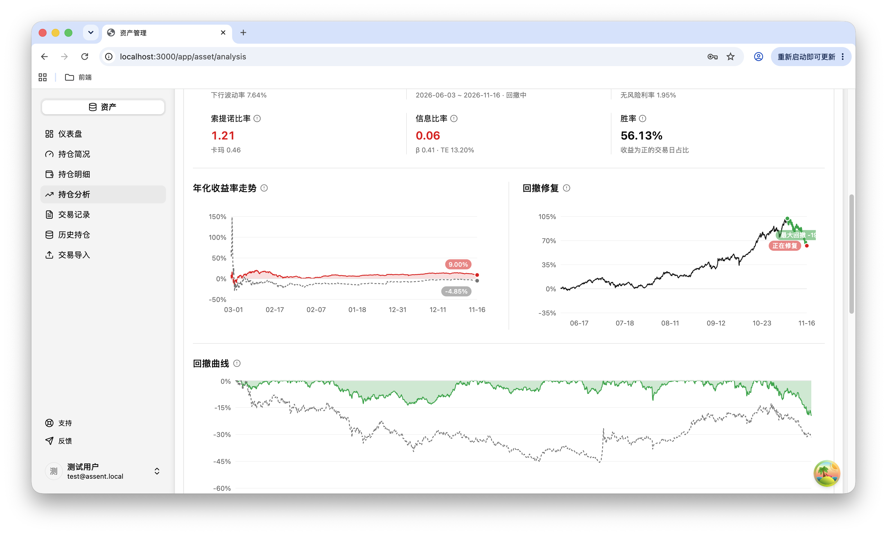
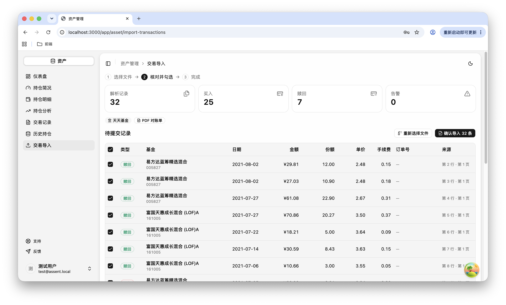
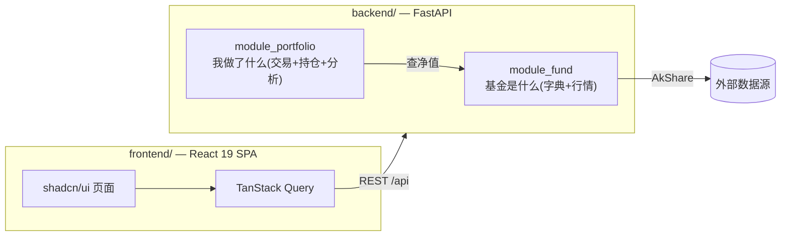
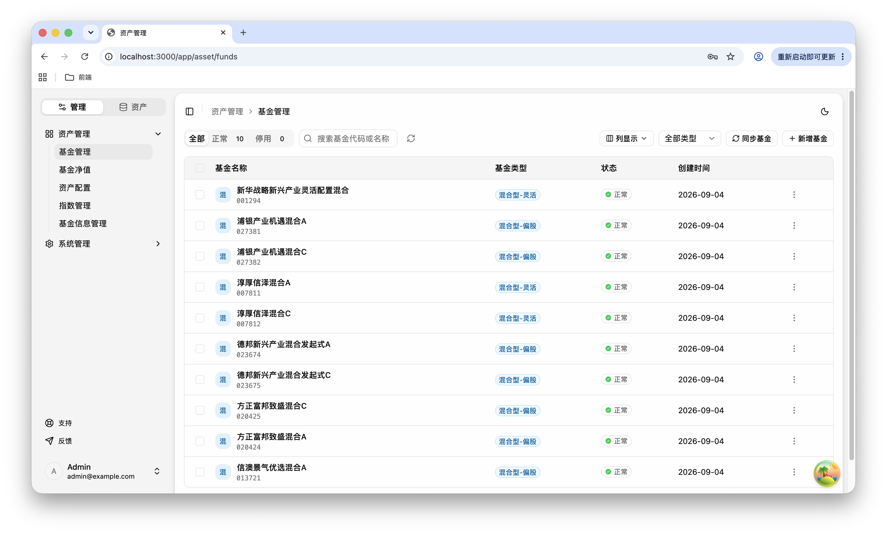

# Assent Allocation Management

基金资产管理与组合分析系统（全栈 Monorepo）——记录你买了哪些基金、花了多少钱、现在值多少钱、赚了多少。




## 功能一览

### 资产管理（业务核心）

| 功能页 | 说明 |
|---|---|
| 资产仪表盘 | 指标卡片（总市值/成本/盈亏、较上周）→ 收益率对比面积图（真实 TWR + 指数基准）→ 持仓表格三段式 |
| 基金管理 | 基金字典 CRUD、AkShare 全量同步、类型/时间档选项 |
| 基金净值管理 | 净值行分页列表、按需同步单只基金历史净值、同步状态筛选 |
| 基金详情 | 同花顺档案全量键值（Redis → DB → AkShare 三级缓存）+ 关键风险指标卡 |
| 指数收益率管理 | 内置指数列表、区间收益率、指数行情同步 |
| 持仓简况 / 持仓明细 | 持仓头表分页、建仓/分批买入/赎回、买卖历史、分散度规则 |
| 交易记录 | 全部买卖流水、行级硬删除、Excel 导出（与导入模板同列形可回导） |
| 历史持仓 | 每日快照分页、行点击抽屉看某日基金明细、季度持仓变化卡片 |
| 持仓分析 | QuantStats 内核：年化波动率、最大回撤分段、夏普/索提诺/卡玛、VaR/CVaR、基准对照 |
| 交易明细导入 | Excel / PDF / 截图上传，平台 YAML 适配 + 分级校验，确认后自动重建持仓与快照 |
| 基金信息管理 | fund_info 缓存表的人工刷新入口（全量/单只回源） |

### 系统管理（脚手架自带）

用户管理、菜单管理、角色管理（三段式按钮权限 `模块:实体:操作`）、字典管理、操作日志。

### 接口防护

- 按用户维度滑动窗口限流（超限真 HTTP 429）
- 权限三分法：管理数据走按钮权限、公共行情数据仅登录 + 限流、持仓私域数据行级隔离
- JWT 认证 + 角色菜单动态路由

## 界面预览

### 持仓简况

总市值、昨日收益、今日收益、持有收益、累计盈亏一目了然；持仓明细表支持按持有收益率排序，持仓占比环形图展示每只基金的市值权重。



### 持仓分析

以 QuantStats 为内核的组合风险画像：年化收益率走势（组合 vs 基准）、最大回撤与修复过程、回撤曲线、索提诺比率、信息比率、胜率、β 与跟踪误差等指标卡。全部指标基于真实净值与 TWR 计算，数据不采样、不估算，每一笔都能在净值历史里溯源。



### 交易明细导入

上传券商导出的 Excel / PDF / 截图对账单后，系统自动解析为结构化交易记录并进入三步确认流程（选择文件 → 核对勾选 → 完成导入），按来源文件逐行列出类型、金额、份额、单价与手续费，人工确认后自动重建持仓与快照。



## 架构



- `module_fund`：基金字典、净值历史（JSONB）、指数行情、AkShare 三级缓存编排（Redis → DB → 外部源）
- `module_portfolio`：持仓/买卖流水/每日快照预计算/现金流，TWR、MWR、Modified Dietz、QuantStats 风险指标

## 技术栈

| 端 | 技术 |
|---|---|
| 前端 | React 19、Vite、react-router v7、TanStack Query v5、shadcn/ui v4、Tailwind CSS v4、Recharts、MSW、Vitest、Playwright |
| 后端 | Python 3.12+、FastAPI、SQLAlchemy 2.0 (async)、PostgreSQL、Redis、AkShare、QuantStats、ruff、pytest |

## 环境要求

- Python 3.12+（开发验证环境 3.13）
- PostgreSQL 14+ 与 Redis 6+（运行中）
- Node.js 20+ 与 pnpm 11+
- 可访问外网（基金/净值/指数数据通过 AkShare 抓取外部源）

## 快速开始

### 1. 启动后端

```bash
cd backend
python3.12 -m venv .venv && source .venv/bin/activate
pip install -e '.[dev]'

# 准备环境变量:复制样例后至少修改 DB_PASSWORD 与 JWT_SECRET_KEY
cp .env.example .env.dev
# JWT_SECRET_KEY 生成: openssl rand -base64 32
```

`.env.dev` 关键字段：

| 字段 | 说明 |
|---|---|
| `DB_HOST` / `DB_PORT` / `DB_USERNAME` / `DB_PASSWORD` / `DB_DATABASE` | PostgreSQL 连接（需先手动建库 `CREATE DATABASE assent_allocation_management;`） |
| `REDIS_HOST` / `REDIS_PORT` | Redis 连接 |
| `JWT_SECRET_KEY` | 必填，`openssl rand -base64 32` 生成 |

启动：

```bash
uvicorn main:app --reload
```

首次启动会**自动建表并执行种子初始化**（管理员账号、系统菜单、角色、字典），无需手动跑脚本。接口文档：<http://localhost:8000/api/docs>

### 2. 启动前端

```bash
cd frontend
pnpm install

cp .env.example .env
# 默认 VITE_APP_API_URL=http://localhost:8000,直连真实后端
# MSW Mock 默认关闭(VITE_APP_ENABLE_API_MOCKING=false)

pnpm dev
```

打开 <http://localhost:3000>。

## 启动后第一步（按顺序做）

新库是空的，按下面顺序操作才有数据可看：

1. **登录**
   使用种子管理员：`admin@assent.local` / `password123`（仅限本地联调，真实部署后必须立即修改）。
   <!-- 📸 图片占位：登录页截图 docs/images/login.png -->
   

2. **同步基金字典**
   侧边栏切到「资产」页签 → 基金管理 → 点击「同步基金」。从 AkShare 全量拉取基金基础信息（代码/名称/类型/公司），该操作限流 2 次/小时，首次约 1~2 分钟。
   <!-- 📸 图片占位：基金管理页同步按钮 docs/images/fund-sync.png -->
   

3. **同步基金净值**
   基金净值管理页 → 对目标基金点击「同步净值」，拉取历史净值（后续分析、收益曲线都依赖它）。

4. **录入持仓**
   持仓简况页 → 建仓（首次买入自动创建持仓），或到「交易明细导入」页用模板批量导入 Excel / PDF / 截图交易记录（确认导入后自动重建持仓）。

5. **生成快照**
   历史持仓页 → 单行工具栏「生成记录」→ 选择日期区间生成每日快照与现金流（持仓分析、历史持仓、占比历史都读快照，不生成则这些页面无数据）。

6. **看分析**
   回到仪表盘查看指标卡与收益率对比面积图；持仓分析页查看 QuantStats 风险指标。

> [!TIP]
> 想脱离后端先看界面？`frontend/.env` 里把 `VITE_APP_ENABLE_API_MOCKING` 改为 `true`，MSW 会在本地拦截全部接口返回模拟数据（仅开发环境生效）。默认配置是关闭的，直连真实后端。

## 常用命令

| 位置 | 命令 | 说明 |
|---|---|---|
| frontend | `pnpm lint` | ESLint |
| frontend | `pnpm check-types` | TypeScript 类型检查 |
| frontend | `pnpm test run` | 单元测试（Vitest） |
| frontend | `pnpm test:e2e` | E2E 测试（自带 mock server） |
| frontend | `pnpm build` | 生产构建 |
| backend | `ruff check .` | Lint |
| backend | `pytest -q` | 测试 |

## CI

`.github/workflows/ci.yml` 按路径触发门禁：改动 `frontend/**` 跑 lint/类型/测试，改动 `backend/**` 跑 ruff/pytest。部署流程不在公开仓库中（私有部署仓库负责）。

## 项目结构

```
├── frontend/
│   ├── src/
│   │   ├── app/routes/          # 路由与页面入口
│   │   ├── features/            # 业务模块(api/组件/hooks 按域组织)
│   │   ├── components/ui/       # shadcn/ui 组件
│   │   ├── config/              # 路由 paths、环境变量
│   │   └── testing/mocks/       # MSW(默认关闭)
│   ├── mock-server.ts           # E2E 专用 mock server
│   └── e2e/                     # Playwright
├── backend/
│   ├── main.py                  # uvicorn 入口
│   ├── app/                     # 应用工厂与生命周期(启动自动初始化种子)
│   ├── module_fund/             # 基金字典/净值/图表/指数
│   ├── module_portfolio/        # 持仓/交易/快照/分析/导入导出
│   ├── module_system/           # 认证/菜单/用户/角色/字典/日志
│   └── db/init_data.py          # 种子数据(管理员/菜单/角色/字典)
└── .github/workflows/ci.yml     # Monorepo 门禁 CI
```

## 常见问题

**登录后接口全报 401？**
前端未登录或 JWT 过期，重新登录即可。检查 `frontend/.env` 的 `VITE_APP_API_URL` 是否指向正在运行的后端。

**基金同步一直转圈/失败？**
AkShare 需要访问外部数据源，确认网络可出公网；该接口限流 2 次/小时，重复触发会 429。

**快照/分析页没数据？**
先在历史持仓页生成快照——分析接口走快照快速路径，没有快照就没有数据。

**想换管理员账号？**
改 `backend/db/init_data.py` 的 `SEED_ADMIN_EMAIL` 后删除数据库重新启动，或登录后在用户管理里改。

**PostgreSQL / Redis 连接失败？**
确认两个服务在运行、`.env.dev` 连接串正确；首次使用需要手动建库。

## 许可证

[MIT](./LICENSE)
